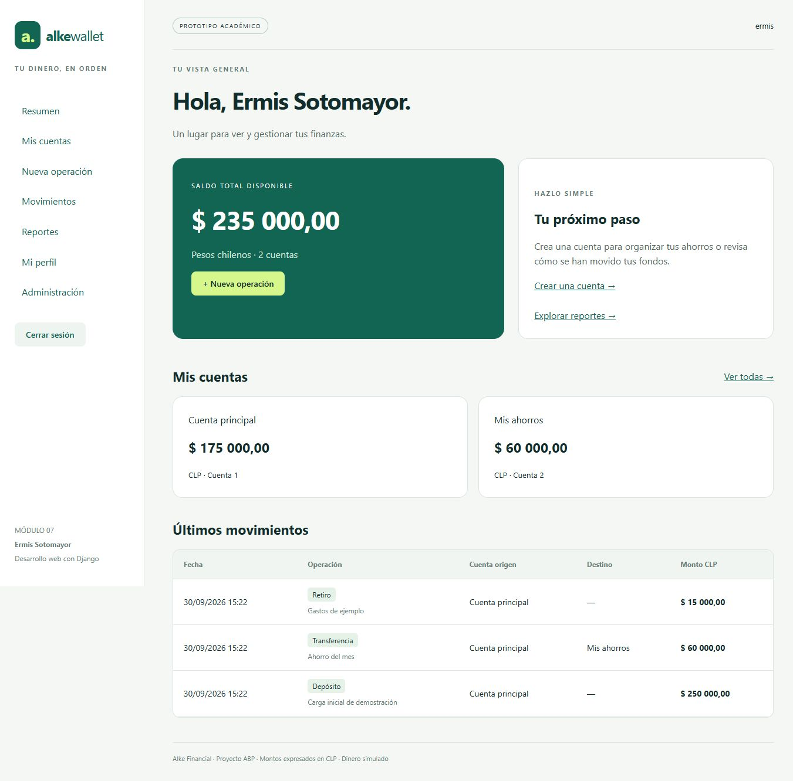

# Alke Wallet · Módulo 7

**Estudiante: Ermis Sotomayor**  
Proyecto ABP: Desarrollo Web con Django · 30 de septiembre de 2026.

Prototipo académico de billetera digital: registro e inicio de sesión, perfiles y contactos, cuentas, depósitos y retiros simulados, transferencias, historial, reportes y exportación CSV. No está conectado a bancos ni procesa dinero real.



## Ejecutar en Windows

Requisitos: Python 3.12 para el iniciador automático (el código también admite 3.10/3.11), acceso a Internet para instalar dependencias y, para editar, Visual Studio Code. Probado con Python 3.12 y Django 4.2.30.

1. Extraer el ZIP completo y abrir la carpeta en Visual Studio Code.
2. Hacer doble clic en `INICIAR.bat`. Crea `.venv`, instala las dependencias, aplica las migraciones y solicita una contraseña para el usuario local **ermis**. No cerrar la consola mientras se usa la aplicación.
3. Abrir <http://127.0.0.1:8000>, ingresar con `ermis` y la contraseña elegida. Si el navegador se abre antes que el servidor, actualizar la página.
4. Para salir, presionar Ctrl+C en la consola. Para iniciar de nuevo, ejecutar el mismo archivo; el comando demo conserva los datos existentes.

Alternativa manual, desde PowerShell en la carpeta del proyecto:

```powershell
py -3.12 -m venv .venv
.\.venv\Scripts\python.exe -m pip install -r requirements.txt
.\.venv\Scripts\python.exe manage.py migrate
.\.venv\Scripts\python.exe manage.py demo
.\.venv\Scripts\python.exe manage.py runserver
```

El comando `demo` crea un superusuario local y datos ficticios. Para usar una base vacía sin demo, omitir ese comando, crear un perfil en `/registro/` y ejecutar `manage.py createsuperuser` para disponer de administración. El superusuario creado de forma manual no tiene perfil de cliente; el registro web sí crea ese perfil.

## Arquitectura

Se usa el patrón MVT de Django. `alke_wallet/settings.py` configura el proyecto; `gestion/models.py` define entidades; `forms.py` valida entradas; `views.py` coordina las vistas; `services.py` concentra los cambios de saldo; `queries.py` contiene consultas de reportes; `templates/` presenta HTML y `static/css/` contiene estilos locales.

```text
User 1 ─── 1 Cliente
Cliente 1 ─── N Cuenta
Cliente N ─── N Cliente (contactos, relación dirigida)
Cuenta 1 ─── N Transaccion (cuenta de origen)
Cuenta 1 ─── N Transaccion (destino opcional)
```

| Entidad | Campos y reglas principales |
|---|---|
| Cliente | Usuario único, nombre, correo único, teléfono validado y contactos |
| Cuenta | Titular, UUID único, alias, saldo decimal no negativo y fecha |
| Transaccion | UUID único, tipo, origen, destino opcional, monto positivo, descripción y fecha |

Los modelos incluyen restricciones de base de datos: saldo no negativo, monto positivo y coherencia de destino. `PROTECT` evita borrar cuentas con historial. Las relaciones usan OneToOneField, ForeignKey y ManyToManyField.

## Base de datos y migraciones

SQLite es la opción local predeterminada. La base se genera al ejecutar `migrate`; no se incluye en Git ni en el ZIP. Las migraciones versionadas son `0001_initial.py` y `0002_alter_transaccion_options.py`.

```powershell
.\.venv\Scripts\python.exe manage.py makemigrations
.\.venv\Scripts\python.exe manage.py migrate
.\.venv\Scripts\python.exe manage.py showmigrations
```

PostgreSQL está configurado mediante variables de entorno y el adaptador `psycopg2-binary`. Ejemplo para PowerShell, sustituyendo los valores por los del servidor:

```powershell
$env:DB_ENGINE = 'postgresql'
$env:DB_NAME = 'alke_wallet'
$env:DB_USER = 'alke_app'
$env:DB_PASSWORD = 'CONTRASENA_DEL_SERVIDOR'
$env:DB_HOST = 'localhost'
$env:DB_PORT = '5432'
.\.venv\Scripts\python.exe manage.py migrate
```

Estas variables se leen desde el entorno; el proyecto no carga archivos `.env` automáticamente. PostgreSQL debe existir y estar accesible. La configuración está implementada, pero no se ejecutaron pruebas contra un servidor PostgreSQL en esta entrega.

La consigna cita Django 3.x/4.x; por compatibilidad didáctica se fija **4.2.30**. Django 4.2 terminó su soporte de seguridad en abril de 2026. Esta entrega se ejecuta localmente. Antes de un despliegue real se debe actualizar a una versión soportada, repetir pruebas sobre PostgreSQL y configurar servidor WSGI, HTTPS, estáticos y secretos. Con `DJANGO_DEBUG=0` se exige `DJANGO_SECRET_KEY`, deben definirse `DJANGO_ALLOWED_HOSTS` y se activan cookies seguras y redirección HTTPS.

## CRUD y seguridad

| Función | Vistas y rutas |
|---|---|
| Crear perfil / leer y actualizar perfil | RegistroView y PerfilView, `/registro/`, `/perfil/<id>/editar/` |
| Eliminar perfil sin cuentas | PerfilDeleteView, `/perfil/<id>/eliminar/`; elimina también su usuario |
| CRUD completo de cuentas | CreateView, ListView, DetailView, UpdateView y DeleteView bajo `/cuentas/` |
| Crear operación y consultar historial | OperacionView y MovimientosView, `/operar/`, `/movimientos/` |
| Reportes / CSV | `/reportes/` y `/reportes/csv/` |
| Administración | `/admin/`, requiere usuario staff |

Cada usuario solo puede consultar, modificar o eliminar sus cuentas y perfil. Las vistas filtran por propietario, incluso si se manipula la URL o un POST. Los formularios llevan CSRF y el cierre de sesión usa POST. Las contraseñas se procesan con `django.contrib.auth` y sus validadores.

El CRUD no permite editar directamente los saldos. Las transacciones confirmadas son inmutables en la interfaz y en el admin: corregirlas borrándolas rompería la trazabilidad. Una cuenta solo se elimina si no tiene saldo ni movimientos; el CRUD completo puede demostrarse con una cuenta recién creada. El administrador es un rol de confianza con acceso global.

`operar()` ejecuta una transacción atómica. Bloquea cuentas en orden estable mediante `select_for_update()` en motores que lo soportan; utiliza actualizaciones condicionales y expresiones `F()` para evitar retiros superiores al saldo. Si una transferencia falla, se revierten los cambios. SQLite no proporciona el bloqueo por fila de PostgreSQL; esta entrega no certifica concurrencia de producción.

## Consultas personalizadas

`queries.py` demuestra `filter()`, `exclude()`, `annotate()`, `Count`, `Sum`, `select_related()` y SQL parametrizado con `raw()`. Todas las consultas de usuario restringen los resultados al titular. El reporte de volumen cuenta cada transacción una vez, incluso en transferencias entre dos cuentas propias; no debe confundirse volumen con saldo.

Ejercicio de CRUD desde la shell, en la base local de demostración:

```python
from gestion.models import Cliente, Cuenta
from gestion.queries import resumen_cuentas, cuentas_con_saldo_sql
c = Cliente.objects.get(usuario__username="ermis")
cuenta = Cuenta.objects.create(cliente=c, alias="Ejemplo shell")
print(Cuenta.objects.filter(cliente=c, saldo=0))
cuenta.alias = "Alias actualizado"
cuenta.save(update_fields=["alias"])
cuenta.delete()  # Solo este registro nuevo, vacío y sin movimientos.
print(list(resumen_cuentas(c.usuario)))
print(list(cuentas_con_saldo_sql(c.usuario)))
```

## Pruebas y demostración

```powershell
.\.venv\Scripts\python.exe manage.py check
.\.venv\Scripts\python.exe manage.py test gestion --verbosity 2
.\.venv\Scripts\python.exe manage.py makemigrations --check --dry-run
```

Se incluyen 20 pruebas automatizadas y un [informe de resultados](docs/INFORME_PRUEBAS.md), junto con la [salida de la ejecución final](docs/resultados_pruebas.txt). El [guion de demostración](docs/DEMOSTRACION.md) permite presentar el prototipo o grabar un video. Las capturas son del navegador real; no se presentan como capturas de Visual Studio Code.

## Git y GitHub

El trabajo local tiene commits descriptivos y las ramas `main`, `feature/modelos` y `feature/crud`. Las ramas de funcionalidades conservan hitos de desarrollo; la documentación final está en `main`. El ZIP incluye una copia del repositorio Git para preservar el historial.

La publicación en GitHub queda pendiente de iniciar sesión en la cuenta del estudiante. Crear allí un repositorio vacío y luego, en esta carpeta:

```powershell
git remote add origin https://github.com/TU_USUARIO/alke-wallet-ermis-sotomayor.git
git push -u origin main
git push origin feature/modelos feature/crud
```

Sustituir `TU_USUARIO` por el usuario real. Si GitHub solicita autenticación, usar el navegador o Git Credential Manager. No enviar contraseñas por chat. No subir `.venv`, bases locales ni secretos. El correo usado en los commits es un identificador local no verificado; puede ajustarse al correo noreply de la cuenta real en futuros commits.

## Reflexión técnica

El ORM expresa las relaciones como objetos y reduce la duplicación de SQL. Las migraciones permiten reproducir y revisar el esquema sin crear tablas manualmente. Las restricciones en base de datos complementan las validaciones de formularios. El SQL parametrizado permite mostrar una consulta directa sin concatenar entradas. Separar operaciones monetarias de las vistas permite probarlas independientemente y reutilizarlas. Las aplicaciones auth, admin y staticfiles aportan autenticación, administración y recursos estáticos sin rehacer esas piezas.

## Referencias

- Consigna suministrada: Proyecto Módulo #7 / ABP, Alke Wallet.
- [Documentación de Django 4.2](https://docs.djangoproject.com/en/4.2/).
- [Transacciones de base de datos](https://docs.djangoproject.com/en/4.2/topics/db/transactions/).
- [Fin de soporte de Django 4.2](https://www.djangoproject.com/weblog/2026/apr/07/security-releases/).

